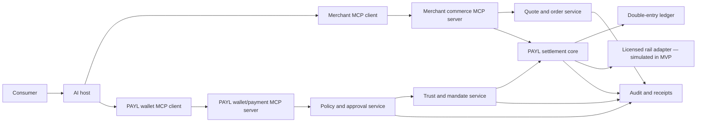
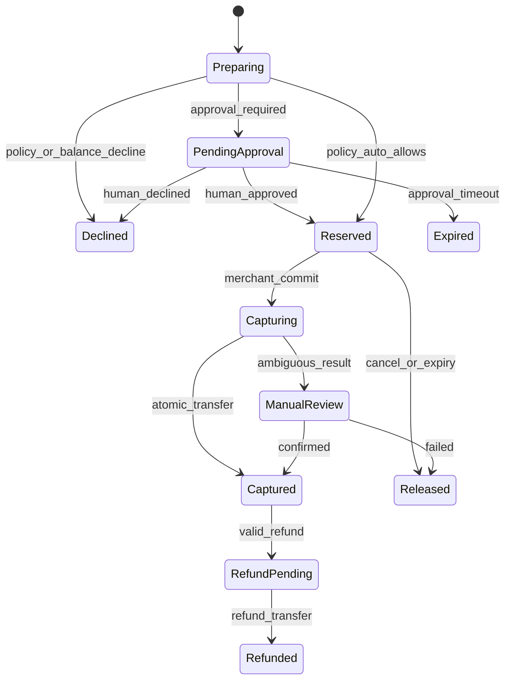
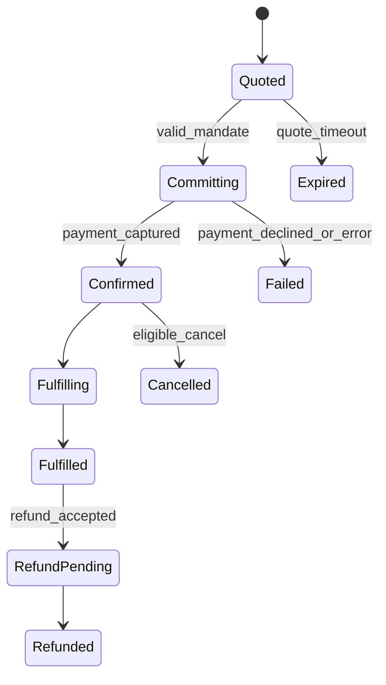

# PAYL Consumer–Merchant MCP Sandbox Specification

## Objective

Demonstrate a complete direct commerce transaction in which a consumer AI connects to a merchant MCP server, receives a signed quote, obtains a PAYL payment mandate, commits the order, and produces matched consumer and merchant receipts.

The sandbox uses simulated funds. Its interfaces should be compatible with a later partner-backed live ledger.

## Protocol model

MCP uses host–client–server connections. In PAYL:

- The consumer's AI application is the **MCP host**.
- The host creates one client connection to the **merchant commerce MCP server**.
- The host creates another client connection to the **PAYL wallet/payment MCP server**.
- The host carries opaque signed objects between the servers.
- The PAYL settlement core verifies and changes financial state outside the model.

The two MCP servers never trust the language model to rewrite quote or mandate fields.

## Architecture

## Canonical transaction sequence

1. Consumer authorizes the AI host to connect to PAYL and a verified merchant.
2. AI calls merchant tools to search offers and requests a quote.
3. Merchant signs an immutable quote.
4. AI passes the exact signed quote to PAYL `payment.prepare`.
5. PAYL verifies merchant, signature, expiry, amount, currency, wallet balance, and consumer policy.
6. If required, PAYL sends a separate approval challenge to the human.
7. PAYL reserves simulated funds and returns an opaque single-use payment mandate.
8. AI calls merchant `commerce.commit_order` with the signed quote and mandate.
9. Merchant gateway submits both objects to PAYL settlement verification.
10. PAYL atomically consumes the mandate, captures the reservation, and credits the merchant payable balance.
11. Merchant fulfills the order and returns a signed order receipt.
12. PAYL links quote, mandate, transfer, order, fulfillment, and receipts in the audit record.

## Signed commerce objects

### SignedQuote

Required claims:

- Schema version.
- Merchant and merchant-server identifiers.
- Quote identifier and nonce.
- Item/service identifiers, quantities, and immutable descriptions.
- Subtotal, discounts, taxes, fees, total, and currency.
- Fulfillment method and estimated completion.
- Refund/cancellation terms reference and terms hash.
- Creation and expiry timestamps.
- Merchant signing-key identifier and signature.

The hash of the canonical SignedQuote becomes the payment binding.

### PaymentMandate

Required claims:

- Schema version and PAYL issuer.
- Unique mandate identifier and anti-replay identifier.
- Opaque consumer/payment-account reference.
- Authorized agent/client identifier.
- Merchant identifier.
- SignedQuote hash.
- Maximum amount and exact currency.
- Single-use flag.
- Authentication/approval level.
- Creation and expiry timestamps.
- Rail mode: sandbox ledger, closed-loop wallet, account transfer, or tokenized instrument.
- PAYL signing-key identifier and signature.

The mandate must not contain a reusable wallet secret, card number, bank credential, private key, or approval token.

### OrderReceipt

Required claims:

- Merchant, order, quote, and mandate identifiers.
- Captured amount and currency.
- Fulfillment status and reference.
- Refund eligibility/expiry.
- PAYL payment reference.
- Creation timestamp and merchant signature.

## Merchant commerce MCP tools

| Tool | Purpose | Side effect |
|---|---|---|
| commerce.search_offers | Search structured merchant offers | None |
| commerce.get_offer | Retrieve current item, price basis, and terms | None |
| commerce.create_quote | Create a signed, expiring quote | Creates quote only |
| commerce.commit_order | Verify mandate and commit the order | Financial/order side effect |
| commerce.get_order | Return permission-scoped order and fulfillment status | None |
| commerce.cancel_order | Cancel eligible unfulfilled order | May trigger release/refund |
| commerce.request_refund | Request refund under merchant terms | Refund side effect |

`commerce.commit_order` must declare a side effect and require both an unmodified SignedQuote and opaque PaymentMandate.

## PAYL wallet/payment MCP tools

| Tool | Purpose | Side effect |
|---|---|---|
| wallet.get_summary | Return limited balance, currency, and policy summary | None |
| wallet.get_policy | Return the connected agent's effective permissions | None |
| payment.prepare | Validate quote, evaluate policy, request approval, and reserve funds | Reservation side effect |
| payment.get_status | Return mandate/payment state | None |
| payment.cancel | Cancel an unused mandate and release funds | Release side effect |
| payment.request_refund | Create a consumer refund request linked to an order | Refund workflow side effect |

No MCP tool approves on behalf of the human. Approval is a separate authenticated user action.

## MCP authorization

- Remote MCP servers use OAuth-based access and protected-resource discovery.
- Consumer authorization is scoped separately for wallet and merchant servers.
- Access tokens are audience-restricted, short-lived, and never shared between servers.
- Merchant server content and tool annotations are untrusted unless the server and signing key are verified.
- The AI host must preserve security boundaries between MCP server connections.

Transport authorization does not replace transaction authorization. The PaymentMandate supplies transaction-specific authority.

## State models

### Payment

### Order

Order and payment states are correlated but not collapsed into one field.

## Core data model

| Entity | Purpose |
|---|---|
| Consumer | Verified user identity and status |
| Merchant | Verified legal/business identity and settlement configuration |
| AgentClient | Linked AI host/client, permissions, and keys |
| MerchantMcpServer | Verified endpoint, tool capabilities, and signing keys |
| Wallet | Currency, state, and regulated partner reference |
| SpendingPolicy | Versioned consumer rules |
| SignedQuote | Merchant-signed commercial commitment |
| ApprovalChallenge | Human consent bound to quote hash |
| PaymentMandate | PAYL-signed, single-use authority |
| PaymentReservation | Reserve, capture, release, and expiry lifecycle |
| Order | Merchant order and fulfillment lifecycle |
| LedgerAccount | Consumer liability, reserve, merchant payable, clearing, fee, and settlement accounts |
| JournalEntry/Line | Balanced immutable financial event |
| Payout | Merchant withdrawal/settlement state |
| Refund/Dispute | Linked post-purchase workflow |
| AuditEvent | Append-only, correlated, redacted evidence |

## Ledger behavior

The sandbox ledger must model:

- Consumer test funding.
- Available-to-reserved transfer.
- Reserved-to-merchant-payable capture.
- Release back to consumer available balance.
- Merchant fee allocation.
- Merchant payout to simulated settlement clearing.
- Full and partial refund.
- Failed payout and return.

Every journal entry balances to zero and uses a unique idempotency key. Displayed balances are derived from journal lines or reconciled projections, not independently mutable source-of-truth fields.

## Security requirements

- OAuth 2.1-style authorization for remote MCP access.
- Signed quotes and mandates with key identifiers, rotation, expiry, and revocation.
- Nonces and unique identifiers preventing replay and relay.
- Canonical serialization before hashing or signing.
- Constant-time signature and token comparison where applicable.
- Merchant, amount, currency, quote, and consumer binding.
- Human approval outside the purchasing agent.
- Strict schema validation and unknown-field policy.
- Prompt-injection-resistant separation of merchant content and financial authorization.
- No secrets or unnecessary personal data in model context, logs, or receipts.
- Tenant/account isolation and least-privilege administration.
- Rate limits, velocity limits, risk flags, and emergency kill switches.
- Signed/authenticated callbacks and durable outbox processing.

## Required test cases

- Quote tampering, expiry, replay, and wrong merchant.
- Mandate tampering, expiry, replay, wrong quote, wrong merchant, and excess amount.
- Human approval replay or agent impersonation.
- Duplicate order commit and capture.
- Concurrent purchases exceeding available balance or policy budget.
- Timeout before and after capture.
- Merchant fulfills without capture and capture occurs without order confirmation.
- Full/partial refund, duplicate refund, and refund after payout.
- Consumer and merchant account isolation.
- Signing-key rotation and revoked key.
- Malicious merchant content attempting to change policy or call wallet tools.
- Complete quote-to-receipt audit dossier.

## Acceptance criteria

- Three merchant tenants use the same MCP commerce schemas.
- One reference AI host completes the two-server flow.
- One hundred completed sandbox orders.
- Ninety-five percent supported-flow completion.
- Every capture matches the exact signed quote and mandate.
- Every journal entry balances.
- Zero unauthorized, replayed, duplicate, or cross-account financial event.
- Every completed order has matched consumer, merchant, payment, and audit receipts.

